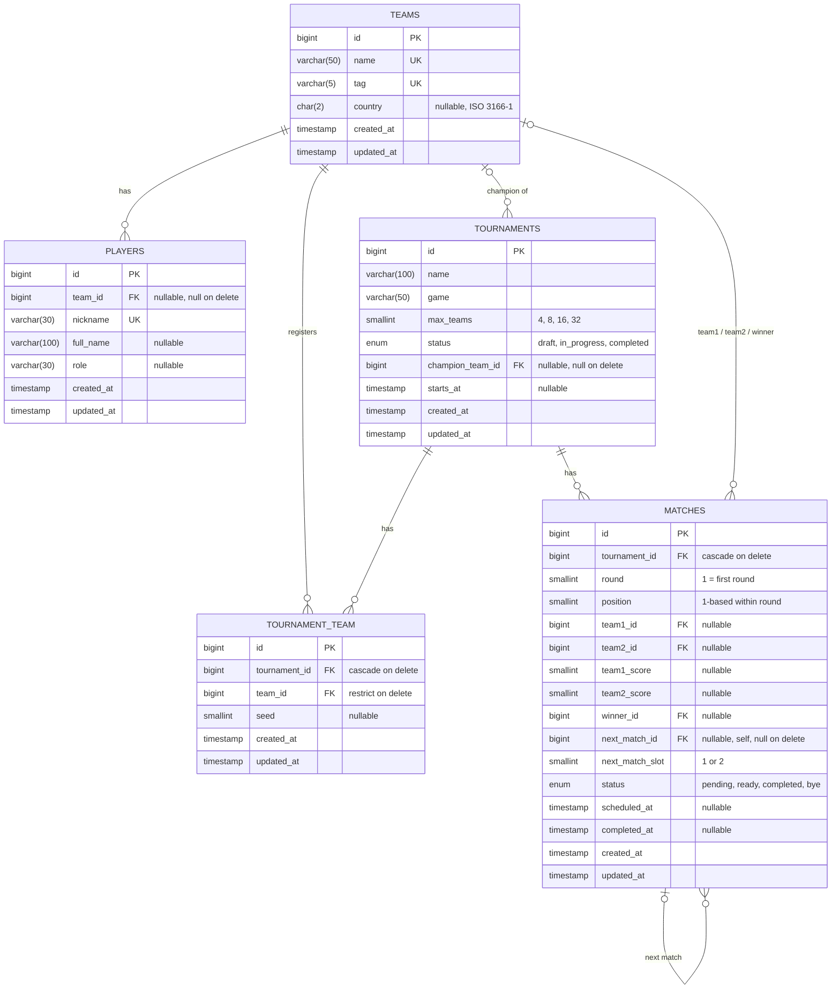

# Tournament Bracket API

A REST API for single elimination tournaments.

## About the project

In a single elimination tournament, a team that loses a match leaves the tournament. The winner of each match plays in the next round, and the winner of the final is the champion.

With this API you can:

- create teams and players;
- create a tournament and register teams in it;
- generate a bracket (the tree of matches);
- save match results, so winners move to the next round;
- see the standings (the place of every team).

Main terms:

- **Team**: has a unique name and a short tag, for example `NAVI`.
- **Player**: plays in one team or has no team (a **free agent**).
- **Tournament**: for 4, 8, 16 or 32 teams. Status: `draft` → `in_progress` → `completed`.
- **Seed**: the rank of a team in a tournament. Seed 1 is the strongest team.
- **Bye**: if there are not enough teams, some teams go to the next round without playing.
- **Match**: status `pending` (teams are not known yet), `ready` (both teams are known), `completed` or `bye`.

## Getting started

```bash
docker compose up -d          # PostgreSQL: databases tournament_bracket and tournament_bracket_test
cp .env.example .env          # database settings are already in .env.example
composer install
php artisan key:generate
php artisan migrate --seed    # tables and demo data
php artisan serve             # API at http://localhost:8000/api
```

Run the tests (they use the `tournament_bracket_test` PostgreSQL database):

```bash
php artisan test
```

## ER diagram



## Business rules

**Registration**

- You can register or remove a team only when the tournament is `draft`. Otherwise: `409`.
- The same team cannot be registered twice: `409`.
- A tournament cannot have more than `max_teams` teams: `409`.
- A team needs at least one player: `422`.
- `seed` is optional. It must be from 1 to `max_teams` and unique in the tournament: `422`.

**Bracket**

- The tournament must be `draft` (`409`) and have at least 2 teams (`422`).
- Seeding: `registration_order` (default) or `random` give seeds 1..N. `manual` uses the seeds that teams already have; they must be exactly 1..N (`422`).
- Bracket size is the smallest power of two that is ≥ N. Number of rounds = log2(size).
- Seeds are placed so that seeds 1 and 2 can meet only in the final.
- A seed bigger than N means a bye: the other team goes to the next round at once.
- After generation the tournament is `in_progress`.
- The bracket can be reset (all matches deleted, tournament back to `draft`) only if no match is played: `409`.

**Results**

- Scores are whole numbers from 0 to 999. A draw is not allowed: `422`.
- Only `ready` and `completed` matches accept a result. `pending` and `bye`: `409`.
- The winner moves to the next match. When both teams of the next match are known, it becomes `ready`.
- After the final, the tournament becomes `completed` and gets a champion.
- You can fix a result only if the next match is not played yet: `409`. If the winner changes, the new winner replaces the old one in the next match.

**Standings**

- Place 1 is the champion, 2 is the final loser, `3-4` are semifinal losers, `5-8` are quarterfinal losers, and so on.
- Teams that still play have `placement: null`.
- Sorted by place, then by score difference.

**Deleting**

- A tournament that is `in_progress` cannot be deleted: `409`.
- A team that is registered in a `draft` or `in_progress` tournament cannot be deleted: `409`.

## Endpoints

All URLs start with `/api`.

| # | Method | URL | Description |
|---|---|---|---|
| 1 | GET | `/teams` | List teams |
| 2 | POST | `/teams` | Create a team |
| 3 | GET | `/teams/{team}` | Get a team with its players |
| 4 | PATCH | `/teams/{team}` | Update a team |
| 5 | DELETE | `/teams/{team}` | Delete a team |
| 6 | GET | `/teams/{team}/players` | List players of a team |
| 7 | POST | `/teams/{team}/players` | Create a player in a team |
| 8 | GET | `/teams/{team}/matches` | Matches of a team |
| 9 | GET | `/players` | List players |
| 10 | GET | `/players/{player}` | Get a player |
| 11 | PATCH | `/players/{player}` | Update a player or move them to another team |
| 12 | DELETE | `/players/{player}` | Delete a player |
| 13 | GET | `/tournaments` | List tournaments |
| 14 | POST | `/tournaments` | Create a tournament |
| 15 | GET | `/tournaments/{tournament}` | Get a tournament |
| 16 | PATCH | `/tournaments/{tournament}` | Update a tournament |
| 17 | DELETE | `/tournaments/{tournament}` | Delete a tournament |
| 18 | GET | `/tournaments/{tournament}/teams` | List registered teams |
| 19 | POST | `/tournaments/{tournament}/teams` | Register a team |
| 20 | DELETE | `/tournaments/{tournament}/teams/{team}` | Withdraw a team |
| 21 | POST | `/tournaments/{tournament}/bracket` | Generate the bracket |
| 22 | GET | `/tournaments/{tournament}/bracket` | Get the bracket |
| 23 | DELETE | `/tournaments/{tournament}/bracket` | Reset the bracket |
| 24 | GET | `/tournaments/{tournament}/matches` | List matches of a tournament |
| 25 | GET | `/tournaments/{tournament}/standings` | Get the standings |
| 26 | GET | `/matches/{match}` | Get a match |
| 27 | PATCH | `/matches/{match}` | Change the match time |
| 28 | PUT | `/matches/{match}/result` | Save or fix a result |

## Teams

### 1. List teams

`GET /api/teams`

Returns a paginated list of teams, sorted by name.

**Query parameters**

| Name | Type | Rules |
|---|---|---|
| search | string | optional, max 50, searches in name and tag (case-insensitive) |
| country | string | optional, 2-letter country code |
| page | integer | optional, min 1 |
| per_page | integer | optional, 1-100, default 15 |

**Success response:** `200 OK`

The list is shortened to one item in this example.

```json
{
  "data": [
    {
      "id": 1,
      "name": "Northern Wolves",
      "tag": "NWLV",
      "country": "SE",
      "players_count": 5,
      "created_at": "2026-11-14T08:44:05.000000Z",
      "updated_at": "2026-11-14T08:44:05.000000Z"
    }
  ],
  "links": {
    "first": "http://localhost:8000/api/teams?search=wolves&page=1",
    "last": "http://localhost:8000/api/teams?search=wolves&page=1",
    "prev": null,
    "next": null
  },
  "meta": {
    "current_page": 1,
    "from": 1,
    "last_page": 1,
    "path": "http://localhost:8000/api/teams",
    "per_page": 15,
    "to": 1,
    "total": 1
  }
}
```

**Errors**

- `422 Unprocessable Content`: a filter is invalid.

  ```json
  {
    "message": "The country field must be 2 characters.",
    "errors": {
      "country": [
        "The country field must be 2 characters."
      ]
    }
  }
  ```

### 2. Create team

`POST /api/teams`

Creates a team. The tag and country are saved in upper case.

**Request body**

| Field | Type | Rules |
|---|---|---|
| name | string | required, max 50, unique |
| tag | string | required, 2-5 characters, only latin letters and digits, unique |
| country | string or null | optional, 2-letter ISO country code |

**Success response:** `201 Created`, header `Location: http://localhost:8000/api/teams/17`

```json
{
  "data": {
    "id": 17,
    "name": "Natus Vincere",
    "tag": "NAVI",
    "country": "UA",
    "created_at": "2026-11-14T08:44:09.000000Z",
    "updated_at": "2026-11-14T08:44:09.000000Z"
  }
}
```

**Errors**

- `422 Unprocessable Content`: the data is invalid.

  ```json
  {
    "message": "The name has already been taken. (and 1 more error)",
    "errors": {
      "name": [
        "The name has already been taken."
      ],
      "tag": [
        "The tag may only contain uppercase latin letters and digits."
      ]
    }
  }
  ```

### 3. Get team

`GET /api/teams/{team}`

Returns a team with its players.

**Path parameters**

| Name | Type | Description |
|---|---|---|
| team | integer | Team id |

**Success response:** `200 OK`

The players list is shortened in this example.

```json
{
  "data": {
    "id": 1,
    "name": "Northern Wolves",
    "tag": "NWLV",
    "country": "SE",
    "players": [
      {
        "id": 1,
        "team_id": 1,
        "nickname": "marilie.russel",
        "full_name": "Roselyn Upton II",
        "role": "Support",
        "is_free_agent": false,
        "created_at": "2026-11-14T08:44:05.000000Z",
        "updated_at": "2026-11-14T08:44:05.000000Z"
      },
      {
        "id": 2,
        "team_id": 1,
        "nickname": "edmond04",
        "full_name": "Marquis Reilly IV",
        "role": "AWPer",
        "is_free_agent": false,
        "created_at": "2026-11-14T08:44:05.000000Z",
        "updated_at": "2026-11-14T08:44:05.000000Z"
      }
    ],
    "created_at": "2026-11-14T08:44:05.000000Z",
    "updated_at": "2026-11-14T08:44:05.000000Z"
  }
}
```

**Errors**

- `404 Not Found`: the team does not exist.

  ```json
  {
    "message": "Team not found."
  }
  ```

### 4. Update team

`PATCH /api/teams/{team}`

Changes only the fields you send.

**Path parameters**

| Name | Type | Description |
|---|---|---|
| team | integer | Team id |

**Request body**

| Field | Type | Rules |
|---|---|---|
| name | string | optional, max 50, unique |
| tag | string | optional, 2-5 latin letters and digits, unique |
| country | string or null | optional, 2-letter ISO country code |

**Success response:** `200 OK`

```json
{
  "data": {
    "id": 17,
    "name": "Natus Vincere Academy",
    "tag": "NAVI",
    "country": "UA",
    "players": [],
    "created_at": "2026-11-14T08:44:09.000000Z",
    "updated_at": "2026-11-14T08:44:09.000000Z"
  }
}
```

**Errors**

- `404 Not Found`: the team does not exist.

  ```json
  {
    "message": "Team not found."
  }
  ```

- `422 Unprocessable Content`: the data is invalid.

  ```json
  {
    "message": "The tag has already been taken.",
    "errors": {
      "tag": [
        "The tag has already been taken."
      ]
    }
  }
  ```

### 5. Delete team

`DELETE /api/teams/{team}`

Deletes a team. Its players become free agents.

**Path parameters**

| Name | Type | Description |
|---|---|---|
| team | integer | Team id |

**Success response:** `204 No Content`

Empty body.

**Errors**

- `404 Not Found`: the team does not exist.

  ```json
  {
    "message": "Team not found."
  }
  ```

- `409 Conflict`: the team is registered in a tournament with status `draft` or `in_progress`.

  ```json
  {
    "message": "Team is registered in a draft or in-progress tournament."
  }
  ```

### 6. List team players

`GET /api/teams/{team}/players`

Returns a paginated list of the team players, sorted by nickname.

**Path parameters**

| Name | Type | Description |
|---|---|---|
| team | integer | Team id |

**Query parameters**

| Name | Type | Rules |
|---|---|---|
| page | integer | optional, min 1 |
| per_page | integer | optional, 1-100, default 15 |

**Success response:** `200 OK`

The list is shortened to one item in this example.

```json
{
  "data": [
    {
      "id": 2,
      "team_id": 1,
      "nickname": "edmond04",
      "full_name": "Marquis Reilly IV",
      "role": "AWPer",
      "is_free_agent": false,
      "created_at": "2026-11-14T08:44:05.000000Z",
      "updated_at": "2026-11-14T08:44:05.000000Z"
    }
  ],
  "links": {
    "first": "http://localhost:8000/api/teams/1/players?page=1",
    "last": "http://localhost:8000/api/teams/1/players?page=1",
    "prev": null,
    "next": null
  },
  "meta": {
    "current_page": 1,
    "from": 1,
    "last_page": 1,
    "path": "http://localhost:8000/api/teams/1/players",
    "per_page": 15,
    "to": 5,
    "total": 5
  }
}
```

**Errors**

- `404 Not Found`: the team does not exist.

  ```json
  {
    "message": "Team not found."
  }
  ```

### 7. Create player in team

`POST /api/teams/{team}/players`

Creates a new player in this team.

**Path parameters**

| Name | Type | Description |
|---|---|---|
| team | integer | Team id |

**Request body**

| Field | Type | Rules |
|---|---|---|
| nickname | string | required, max 30, unique |
| full_name | string or null | optional, max 100 |
| role | string or null | optional, max 30 |

**Success response:** `201 Created`, header `Location: http://localhost:8000/api/players/84`

```json
{
  "data": {
    "id": 84,
    "team_id": 17,
    "nickname": "s1mple",
    "full_name": "Oleksandr Kostyliev",
    "role": "AWPer",
    "is_free_agent": false,
    "team": {
      "id": 17,
      "name": "Natus Vincere Academy",
      "tag": "NAVI",
      "country": "UA",
      "created_at": "2026-11-14T08:44:09.000000Z",
      "updated_at": "2026-11-14T08:44:09.000000Z"
    },
    "created_at": "2026-11-14T08:44:09.000000Z",
    "updated_at": "2026-11-14T08:44:09.000000Z"
  }
}
```

**Errors**

- `404 Not Found`: the team does not exist.

  ```json
  {
    "message": "Team not found."
  }
  ```

- `422 Unprocessable Content`: the data is invalid.

  ```json
  {
    "message": "The nickname has already been taken.",
    "errors": {
      "nickname": [
        "The nickname has already been taken."
      ]
    }
  }
  ```

### 8. Team match history

`GET /api/teams/{team}/matches`

Returns a paginated list of matches where the team plays.

**Path parameters**

| Name | Type | Description |
|---|---|---|
| team | integer | Team id |

**Query parameters**

| Name | Type | Rules |
|---|---|---|
| tournament_id | integer | optional |
| status | string | optional, one of `pending`, `ready`, `completed`, `bye` |
| page | integer | optional, min 1 |
| per_page | integer | optional, 1-100, default 15 |

**Success response:** `200 OK`

The list is shortened to one item in this example.

```json
{
  "data": [
    {
      "id": 8,
      "tournament_id": 3,
      "round": 1,
      "position": 1,
      "team1_id": 13,
      "team2_id": 16,
      "team1": {
        "id": 13,
        "name": "Night Panthers",
        "tag": "NPTH",
        "country": "UA",
        "created_at": "2026-11-14T08:44:06.000000Z",
        "updated_at": "2026-11-14T08:44:06.000000Z"
      },
      "team2": {
        "id": 16,
        "name": "Red Bears",
        "tag": "RBRS",
        "country": "CZ",
        "created_at": "2026-11-14T08:44:06.000000Z",
        "updated_at": "2026-11-14T08:44:06.000000Z"
      },
      "team1_score": 12,
      "team2_score": 14,
      "winner_id": 16,
      "winner": {
        "id": 16,
        "name": "Red Bears",
        "tag": "RBRS",
        "country": "CZ",
        "created_at": "2026-11-14T08:44:06.000000Z",
        "updated_at": "2026-11-14T08:44:06.000000Z"
      },
      "next_match_id": 10,
      "next_match_slot": 1,
      "status": "completed",
      "scheduled_at": null,
      "completed_at": "2026-11-14T08:44:06.000000Z",
      "created_at": "2026-11-14T08:44:06.000000Z",
      "updated_at": "2026-11-14T08:44:06.000000Z"
    }
  ],
  "links": {
    "first": "http://localhost:8000/api/teams/13/matches?status=completed&page=1",
    "last": "http://localhost:8000/api/teams/13/matches?status=completed&page=1",
    "prev": null,
    "next": null
  },
  "meta": {
    "current_page": 1,
    "from": 1,
    "last_page": 1,
    "path": "http://localhost:8000/api/teams/13/matches",
    "per_page": 15,
    "to": 2,
    "total": 2
  }
}
```

**Errors**

- `404 Not Found`: the team does not exist.

  ```json
  {
    "message": "Team not found."
  }
  ```

- `422 Unprocessable Content`: a filter is invalid.

  ```json
  {
    "message": "The selected status is invalid.",
    "errors": {
      "status": [
        "The selected status is invalid."
      ]
    }
  }
  ```

## Players

### 9. List players

`GET /api/players`

Returns a paginated list of players with their teams, sorted by nickname.

**Query parameters**

| Name | Type | Rules |
|---|---|---|
| team_id | integer | optional |
| free_agent | boolean | optional, `true` or `false`; `true` returns only players without a team |
| page | integer | optional, min 1 |
| per_page | integer | optional, 1-100, default 15 |

**Success response:** `200 OK`

The list is shortened to one item in this example.

```json
{
  "data": [
    {
      "id": 83,
      "team_id": null,
      "nickname": "anabel.feest",
      "full_name": "Dr. Wendell DuBuque V",
      "role": "Lurker",
      "is_free_agent": true,
      "team": null,
      "created_at": "2026-11-14T08:44:06.000000Z",
      "updated_at": "2026-11-14T08:44:06.000000Z"
    }
  ],
  "links": {
    "first": "http://localhost:8000/api/players?free_agent=true&page=1",
    "last": "http://localhost:8000/api/players?free_agent=true&page=1",
    "prev": null,
    "next": null
  },
  "meta": {
    "current_page": 1,
    "from": 1,
    "last_page": 1,
    "path": "http://localhost:8000/api/players",
    "per_page": 15,
    "to": 3,
    "total": 3
  }
}
```

**Errors**

- `422 Unprocessable Content`: a filter is invalid.

  ```json
  {
    "message": "The selected free agent is invalid.",
    "errors": {
      "free_agent": [
        "The selected free agent is invalid."
      ]
    }
  }
  ```

### 10. Get player

`GET /api/players/{player}`

Returns a player with the team. `team` is `null` for a free agent.

**Path parameters**

| Name | Type | Description |
|---|---|---|
| player | integer | Player id |

**Success response:** `200 OK`

```json
{
  "data": {
    "id": 84,
    "team_id": 17,
    "nickname": "s1mple",
    "full_name": "Oleksandr Kostyliev",
    "role": "AWPer",
    "is_free_agent": false,
    "team": {
      "id": 17,
      "name": "Natus Vincere Academy",
      "tag": "NAVI",
      "country": "UA",
      "created_at": "2026-11-14T08:44:09.000000Z",
      "updated_at": "2026-11-14T08:44:09.000000Z"
    },
    "created_at": "2026-11-14T08:44:09.000000Z",
    "updated_at": "2026-11-14T08:44:09.000000Z"
  }
}
```

**Errors**

- `404 Not Found`: the player does not exist.

  ```json
  {
    "message": "Player not found."
  }
  ```

### 11. Update player

`PATCH /api/players/{player}`

Changes only the fields you send. Send `team_id` to move the player to another team, or `null` to make them a free agent.

**Path parameters**

| Name | Type | Description |
|---|---|---|
| player | integer | Player id |

**Request body**

| Field | Type | Rules |
|---|---|---|
| team_id | integer or null | optional, the team must exist |
| nickname | string | optional, max 30, unique |
| full_name | string or null | optional, max 100 |
| role | string or null | optional, max 30 |

**Success response:** `200 OK`

```json
{
  "data": {
    "id": 84,
    "team_id": 2,
    "nickname": "s1mple",
    "full_name": "Oleksandr Kostyliev",
    "role": "Entry",
    "is_free_agent": false,
    "team": {
      "id": 2,
      "name": "Crimson Foxes",
      "tag": "CRFX",
      "country": "DE",
      "created_at": "2026-11-14T08:44:05.000000Z",
      "updated_at": "2026-11-14T08:44:05.000000Z"
    },
    "created_at": "2026-11-14T08:44:09.000000Z",
    "updated_at": "2026-11-14T08:44:10.000000Z"
  }
}
```

**Errors**

- `404 Not Found`: the player does not exist.

  ```json
  {
    "message": "Player not found."
  }
  ```

- `422 Unprocessable Content`: the data is invalid.

  ```json
  {
    "message": "The selected team id is invalid.",
    "errors": {
      "team_id": [
        "The selected team id is invalid."
      ]
    }
  }
  ```

### 12. Delete player

`DELETE /api/players/{player}`

Deletes a player.

**Path parameters**

| Name | Type | Description |
|---|---|---|
| player | integer | Player id |

**Success response:** `204 No Content`

Empty body.

**Errors**

- `404 Not Found`: the player does not exist.

  ```json
  {
    "message": "Player not found."
  }
  ```

## Tournaments

### 13. List tournaments

`GET /api/tournaments`

Returns a paginated list of tournaments, newest first.

**Query parameters**

| Name | Type | Rules |
|---|---|---|
| status | string | optional, one of `draft`, `in_progress`, `completed` |
| game | string | optional, max 50, exact game name (case-insensitive) |
| page | integer | optional, min 1 |
| per_page | integer | optional, 1-100, default 15 |

**Success response:** `200 OK`

The list is shortened to one item in this example.

```json
{
  "data": [
    {
      "id": 3,
      "name": "Summer Cup 2026",
      "game": "Valorant",
      "max_teams": 4,
      "status": "completed",
      "teams_count": 4,
      "champion_team_id": 14,
      "champion": {
        "id": 14,
        "name": "Storm Falcons",
        "tag": "STFL",
        "country": "DK",
        "created_at": "2026-11-14T08:44:06.000000Z",
        "updated_at": "2026-11-14T08:44:06.000000Z"
      },
      "starts_at": "2026-08-14T08:44:06.000000Z",
      "created_at": "2026-11-14T08:44:06.000000Z",
      "updated_at": "2026-11-14T08:44:06.000000Z"
    }
  ],
  "links": {
    "first": "http://localhost:8000/api/tournaments?status=completed&page=1",
    "last": "http://localhost:8000/api/tournaments?status=completed&page=1",
    "prev": null,
    "next": null
  },
  "meta": {
    "current_page": 1,
    "from": 1,
    "last_page": 1,
    "path": "http://localhost:8000/api/tournaments",
    "per_page": 15,
    "to": 1,
    "total": 1
  }
}
```

**Errors**

- `422 Unprocessable Content`: a filter is invalid.

  ```json
  {
    "message": "The selected status is invalid.",
    "errors": {
      "status": [
        "The selected status is invalid."
      ]
    }
  }
  ```

### 14. Create tournament

`POST /api/tournaments`

Creates a tournament. The status is always `draft`.

**Request body**

| Field | Type | Rules |
|---|---|---|
| name | string | required, max 100 |
| game | string | required, max 50 |
| max_teams | integer | required, one of 4, 8, 16, 32 |
| starts_at | date or null | optional, for example `2027-03-01T12:00:00Z` |

**Success response:** `201 Created`, header `Location: http://localhost:8000/api/tournaments/4`

```json
{
  "data": {
    "id": 4,
    "name": "Spring Cup 2027",
    "game": "Counter-Strike 2",
    "max_teams": 8,
    "status": "draft",
    "teams_count": 0,
    "champion_team_id": null,
    "champion": null,
    "starts_at": "2027-03-01T12:00:00.000000Z",
    "created_at": "2026-11-14T08:44:10.000000Z",
    "updated_at": "2026-11-14T08:44:10.000000Z"
  }
}
```

**Errors**

- `422 Unprocessable Content`: the data is invalid.

  ```json
  {
    "message": "The max teams must be one of: 4, 8, 16, 32.",
    "errors": {
      "max_teams": [
        "The max teams must be one of: 4, 8, 16, 32."
      ]
    }
  }
  ```

### 15. Get tournament

`GET /api/tournaments/{tournament}`

Returns a tournament with the number of teams and the champion.

**Path parameters**

| Name | Type | Description |
|---|---|---|
| tournament | integer | Tournament id |

**Success response:** `200 OK`

```json
{
  "data": {
    "id": 3,
    "name": "Summer Cup 2026",
    "game": "Valorant",
    "max_teams": 4,
    "status": "completed",
    "teams_count": 4,
    "champion_team_id": 14,
    "champion": {
      "id": 14,
      "name": "Storm Falcons",
      "tag": "STFL",
      "country": "DK",
      "created_at": "2026-11-14T08:44:06.000000Z",
      "updated_at": "2026-11-14T08:44:06.000000Z"
    },
    "starts_at": "2026-08-14T08:44:06.000000Z",
    "created_at": "2026-11-14T08:44:06.000000Z",
    "updated_at": "2026-11-14T08:44:06.000000Z"
  }
}
```

**Errors**

- `404 Not Found`: the tournament does not exist.

  ```json
  {
    "message": "Tournament not found."
  }
  ```

### 16. Update tournament

`PATCH /api/tournaments/{tournament}`

Changes only the fields you send. `max_teams` can be changed only in `draft` and cannot be less than the number of registered teams.

**Path parameters**

| Name | Type | Description |
|---|---|---|
| tournament | integer | Tournament id |

**Request body**

| Field | Type | Rules |
|---|---|---|
| name | string | optional, max 100 |
| game | string | optional, max 50 |
| max_teams | integer | optional, one of 4, 8, 16, 32 |
| starts_at | date or null | optional |

**Success response:** `200 OK`

```json
{
  "data": {
    "id": 4,
    "name": "Spring Cup 2027",
    "game": "Counter-Strike 2",
    "max_teams": 4,
    "status": "draft",
    "teams_count": 0,
    "champion_team_id": null,
    "champion": null,
    "starts_at": "2027-03-01T12:00:00.000000Z",
    "created_at": "2026-11-14T08:44:10.000000Z",
    "updated_at": "2026-11-14T08:44:10.000000Z"
  }
}
```

**Errors**

- `404 Not Found`: the tournament does not exist.

  ```json
  {
    "message": "Tournament not found."
  }
  ```

- `409 Conflict`: `max_teams` is changed when the tournament is not in `draft`.

  ```json
  {
    "message": "Max teams can only be changed while the tournament is in draft."
  }
  ```

- `422 Unprocessable Content`: the data is invalid, or `max_teams` is less than the number of registered teams.

  ```json
  {
    "message": "The max teams may not be less than the number of registered teams (6).",
    "errors": {
      "max_teams": [
        "The max teams may not be less than the number of registered teams (6)."
      ]
    }
  }
  ```

### 17. Delete tournament

`DELETE /api/tournaments/{tournament}`

Deletes a tournament in `draft` or `completed` status, together with its registrations and matches.

**Path parameters**

| Name | Type | Description |
|---|---|---|
| tournament | integer | Tournament id |

**Success response:** `204 No Content`

Empty body.

**Errors**

- `404 Not Found`: the tournament does not exist.

  ```json
  {
    "message": "Tournament not found."
  }
  ```

- `409 Conflict`: the tournament is `in_progress`.

  ```json
  {
    "message": "Cannot delete a tournament that is in progress."
  }
  ```

## Registration

### 18. List registered teams

`GET /api/tournaments/{tournament}/teams`

Returns a paginated list of registered teams with their seeds. Teams with a seed come first, sorted by seed.

**Path parameters**

| Name | Type | Description |
|---|---|---|
| tournament | integer | Tournament id |

**Query parameters**

| Name | Type | Rules |
|---|---|---|
| page | integer | optional, min 1 |
| per_page | integer | optional, 1-100, default 15 |

**Success response:** `200 OK`

The list is shortened to one item in this example.

```json
{
  "data": [
    {
      "id": 7,
      "name": "Golden Tigers",
      "tag": "GTGR",
      "country": "BR",
      "seed": 1,
      "players_count": 5,
      "created_at": "2026-11-14T08:44:06.000000Z",
      "updated_at": "2026-11-14T08:44:06.000000Z"
    }
  ],
  "links": {
    "first": "http://localhost:8000/api/tournaments/2/teams?page=1",
    "last": "http://localhost:8000/api/tournaments/2/teams?page=1",
    "prev": null,
    "next": null
  },
  "meta": {
    "current_page": 1,
    "from": 1,
    "last_page": 1,
    "path": "http://localhost:8000/api/tournaments/2/teams",
    "per_page": 15,
    "to": 8,
    "total": 8
  }
}
```

**Errors**

- `404 Not Found`: the tournament does not exist.

  ```json
  {
    "message": "Tournament not found."
  }
  ```

### 19. Register team

`POST /api/tournaments/{tournament}/teams`

Registers a team in a tournament. Works only while the tournament is in `draft`.

**Path parameters**

| Name | Type | Description |
|---|---|---|
| tournament | integer | Tournament id |

**Request body**

| Field | Type | Rules |
|---|---|---|
| team_id | integer | required, the team must exist and have at least one player |
| seed | integer or null | optional, from 1 to `max_teams`, unique in the tournament |

**Success response:** `201 Created`, header `Location: http://localhost:8000/api/tournaments/4/teams`

```json
{
  "data": {
    "id": 1,
    "name": "Northern Wolves",
    "tag": "NWLV",
    "country": "SE",
    "seed": 1,
    "players_count": 5,
    "created_at": "2026-11-14T08:44:05.000000Z",
    "updated_at": "2026-11-14T08:44:05.000000Z"
  }
}
```

**Errors**

- `404 Not Found`: the tournament does not exist.

  ```json
  {
    "message": "Tournament not found."
  }
  ```

- `409 Conflict`: the tournament is not in `draft`.

  ```json
  {
    "message": "Registration is closed: bracket already generated."
  }
  ```

- `409 Conflict`: the team is already registered.

  ```json
  {
    "message": "Team is already registered in this tournament."
  }
  ```

- `409 Conflict`: the tournament already has `max_teams` teams.

  ```json
  {
    "message": "Tournament is full: maximum of 4 teams reached."
  }
  ```

- `422 Unprocessable Content`: the team has no players.

  ```json
  {
    "message": "The team must have at least one player to be registered.",
    "errors": {
      "team_id": [
        "The team must have at least one player to be registered."
      ]
    }
  }
  ```

- `422 Unprocessable Content`: the seed is out of range or already taken.

  ```json
  {
    "message": "The seed field must be between 1 and 8.",
    "errors": {
      "seed": [
        "The seed field must be between 1 and 8."
      ]
    }
  }
  ```

### 20. Withdraw team

`DELETE /api/tournaments/{tournament}/teams/{team}`

Removes a team from a tournament. Works only while the tournament is in `draft`.

**Path parameters**

| Name | Type | Description |
|---|---|---|
| tournament | integer | Tournament id |
| team | integer | Team id |

**Success response:** `204 No Content`

Empty body.

**Errors**

- `404 Not Found`: the tournament or the team does not exist, or the team is not registered in this tournament.

  ```json
  {
    "message": "Team not found."
  }
  ```

- `409 Conflict`: the tournament is not in `draft`.

  ```json
  {
    "message": "Registration is closed: bracket already generated."
  }
  ```

## Bracket

### 21. Generate bracket

`POST /api/tournaments/{tournament}/bracket`

Creates all matches of the bracket and moves the tournament to `in_progress`. With 6 teams the bracket size is 8, so seeds 1 and 2 get a bye.

**Path parameters**

| Name | Type | Description |
|---|---|---|
| tournament | integer | Tournament id |

**Request body**

| Field | Type | Rules |
|---|---|---|
| seeding | string | optional, one of `registration_order` (default), `random`, `manual` |

**Success response:** `201 Created`, header `Location: http://localhost:8000/api/tournaments/1/bracket`

The rounds are shortened in this example.

```json
{
  "data": {
    "tournament_id": 1,
    "status": "in_progress",
    "size": 8,
    "champion": null,
    "rounds": [
      {
        "round": 1,
        "name": "Quarterfinal",
        "matches": [
          {
            "id": 11,
            "tournament_id": 1,
            "round": 1,
            "position": 1,
            "team1_id": 1,
            "team2_id": null,
            "team1": {
              "id": 1,
              "name": "Northern Wolves",
              "tag": "NWLV",
              "country": "SE",
              "created_at": "2026-11-14T08:44:05.000000Z",
              "updated_at": "2026-11-14T08:44:05.000000Z"
            },
            "team2": null,
            "team1_score": null,
            "team2_score": null,
            "winner_id": 1,
            "winner": {
              "id": 1,
              "name": "Northern Wolves",
              "tag": "NWLV",
              "country": "SE",
              "created_at": "2026-11-14T08:44:05.000000Z",
              "updated_at": "2026-11-14T08:44:05.000000Z"
            },
            "next_match_id": 15,
            "next_match_slot": 1,
            "status": "bye",
            "scheduled_at": null,
            "completed_at": null,
            "created_at": "2026-11-14T08:44:12.000000Z",
            "updated_at": "2026-11-14T08:44:12.000000Z"
          },
          {
            "id": 12,
            "tournament_id": 1,
            "round": 1,
            "position": 2,
            "team1_id": 4,
            "team2_id": 5,
            "team1": {
              "id": 4,
              "name": "Silent Owls",
              "tag": "SOWL",
              "country": "FI",
              "created_at": "2026-11-14T08:44:06.000000Z",
              "updated_at": "2026-11-14T08:44:06.000000Z"
            },
            "team2": {
              "id": 5,
              "name": "Steppe Eagles",
              "tag": "STEG",
              "country": "KZ",
              "created_at": "2026-11-14T08:44:06.000000Z",
              "updated_at": "2026-11-14T08:44:06.000000Z"
            },
            "team1_score": null,
            "team2_score": null,
            "winner_id": null,
            "winner": null,
            "next_match_id": 15,
            "next_match_slot": 2,
            "status": "ready",
            "scheduled_at": null,
            "completed_at": null,
            "created_at": "2026-11-14T08:44:12.000000Z",
            "updated_at": "2026-11-14T08:44:12.000000Z"
          }
        ]
      },
      {
        "round": 2,
        "name": "Semifinal",
        "matches": [
          {
            "id": 15,
            "tournament_id": 1,
            "round": 2,
            "position": 1,
            "team1_id": 1,
            "team2_id": null,
            "team1": {
              "id": 1,
              "name": "Northern Wolves",
              "tag": "NWLV",
              "country": "SE",
              "created_at": "2026-11-14T08:44:05.000000Z",
              "updated_at": "2026-11-14T08:44:05.000000Z"
            },
            "team2": null,
            "team1_score": null,
            "team2_score": null,
            "winner_id": null,
            "winner": null,
            "next_match_id": 17,
            "next_match_slot": 1,
            "status": "pending",
            "scheduled_at": null,
            "completed_at": null,
            "created_at": "2026-11-14T08:44:12.000000Z",
            "updated_at": "2026-11-14T08:44:12.000000Z"
          }
        ]
      },
      {
        "round": 3,
        "name": "Final",
        "matches": [
          {
            "id": 17,
            "tournament_id": 1,
            "round": 3,
            "position": 1,
            "team1_id": null,
            "team2_id": null,
            "team1": null,
            "team2": null,
            "team1_score": null,
            "team2_score": null,
            "winner_id": null,
            "winner": null,
            "next_match_id": null,
            "next_match_slot": null,
            "status": "pending",
            "scheduled_at": null,
            "completed_at": null,
            "created_at": "2026-11-14T08:44:12.000000Z",
            "updated_at": "2026-11-14T08:44:12.000000Z"
          }
        ]
      }
    ]
  }
}
```

**Errors**

- `404 Not Found`: the tournament does not exist.

  ```json
  {
    "message": "Tournament not found."
  }
  ```

- `409 Conflict`: the tournament is not in `draft`.

  ```json
  {
    "message": "Bracket can only be generated for a draft tournament."
  }
  ```

- `422 Unprocessable Content`: `manual` seeding is used, but the seeds are not exactly 1..N.

  ```json
  {
    "message": "Manual seeding requires every registered team to have a unique seed from 1 to 6 without gaps.",
    "errors": {
      "seeding": [
        "Manual seeding requires every registered team to have a unique seed from 1 to 6 without gaps."
      ]
    }
  }
  ```

- `422 Unprocessable Content`: fewer than 2 teams are registered.

  ```json
  {
    "message": "At least 2 registered teams are required to generate a bracket.",
    "errors": {
      "teams": [
        "At least 2 registered teams are required to generate a bracket."
      ]
    }
  }
  ```

### 22. Get bracket

`GET /api/tournaments/{tournament}/bracket`

Returns the bracket grouped by rounds. Round names are: Final, Semifinal, Quarterfinal, Round of 16, Round of 32.

**Path parameters**

| Name | Type | Description |
|---|---|---|
| tournament | integer | Tournament id |

**Success response:** `200 OK`

The rounds are shortened in this example.

```json
{
  "data": {
    "tournament_id": 1,
    "status": "in_progress",
    "size": 8,
    "champion": null,
    "rounds": [
      {
        "round": 1,
        "name": "Quarterfinal",
        "matches": [
          {
            "id": 11,
            "tournament_id": 1,
            "round": 1,
            "position": 1,
            "team1_id": 1,
            "team2_id": null,
            "team1": {
              "id": 1,
              "name": "Northern Wolves",
              "tag": "NWLV",
              "country": "SE",
              "created_at": "2026-11-14T08:44:05.000000Z",
              "updated_at": "2026-11-14T08:44:05.000000Z"
            },
            "team2": null,
            "team1_score": null,
            "team2_score": null,
            "winner_id": 1,
            "winner": {
              "id": 1,
              "name": "Northern Wolves",
              "tag": "NWLV",
              "country": "SE",
              "created_at": "2026-11-14T08:44:05.000000Z",
              "updated_at": "2026-11-14T08:44:05.000000Z"
            },
            "next_match_id": 15,
            "next_match_slot": 1,
            "status": "bye",
            "scheduled_at": null,
            "completed_at": null,
            "created_at": "2026-11-14T08:44:12.000000Z",
            "updated_at": "2026-11-14T08:44:12.000000Z"
          },
          {
            "id": 12,
            "tournament_id": 1,
            "round": 1,
            "position": 2,
            "team1_id": 4,
            "team2_id": 5,
            "team1": {
              "id": 4,
              "name": "Silent Owls",
              "tag": "SOWL",
              "country": "FI",
              "created_at": "2026-11-14T08:44:06.000000Z",
              "updated_at": "2026-11-14T08:44:06.000000Z"
            },
            "team2": {
              "id": 5,
              "name": "Steppe Eagles",
              "tag": "STEG",
              "country": "KZ",
              "created_at": "2026-11-14T08:44:06.000000Z",
              "updated_at": "2026-11-14T08:44:06.000000Z"
            },
            "team1_score": null,
            "team2_score": null,
            "winner_id": null,
            "winner": null,
            "next_match_id": 15,
            "next_match_slot": 2,
            "status": "ready",
            "scheduled_at": null,
            "completed_at": null,
            "created_at": "2026-11-14T08:44:12.000000Z",
            "updated_at": "2026-11-14T08:44:12.000000Z"
          }
        ]
      },
      {
        "round": 2,
        "name": "Semifinal",
        "matches": [
          {
            "id": 15,
            "tournament_id": 1,
            "round": 2,
            "position": 1,
            "team1_id": 1,
            "team2_id": null,
            "team1": {
              "id": 1,
              "name": "Northern Wolves",
              "tag": "NWLV",
              "country": "SE",
              "created_at": "2026-11-14T08:44:05.000000Z",
              "updated_at": "2026-11-14T08:44:05.000000Z"
            },
            "team2": null,
            "team1_score": null,
            "team2_score": null,
            "winner_id": null,
            "winner": null,
            "next_match_id": 17,
            "next_match_slot": 1,
            "status": "pending",
            "scheduled_at": null,
            "completed_at": null,
            "created_at": "2026-11-14T08:44:12.000000Z",
            "updated_at": "2026-11-14T08:44:12.000000Z"
          }
        ]
      },
      {
        "round": 3,
        "name": "Final",
        "matches": [
          {
            "id": 17,
            "tournament_id": 1,
            "round": 3,
            "position": 1,
            "team1_id": null,
            "team2_id": null,
            "team1": null,
            "team2": null,
            "team1_score": null,
            "team2_score": null,
            "winner_id": null,
            "winner": null,
            "next_match_id": null,
            "next_match_slot": null,
            "status": "pending",
            "scheduled_at": null,
            "completed_at": null,
            "created_at": "2026-11-14T08:44:12.000000Z",
            "updated_at": "2026-11-14T08:44:12.000000Z"
          }
        ]
      }
    ]
  }
}
```

**Errors**

- `404 Not Found`: the tournament does not exist or the bracket is not generated yet.

  ```json
  {
    "message": "Bracket has not been generated yet."
  }
  ```

### 23. Reset bracket

`DELETE /api/tournaments/{tournament}/bracket`

Deletes all matches and moves the tournament back to `draft`.

**Path parameters**

| Name | Type | Description |
|---|---|---|
| tournament | integer | Tournament id |

**Success response:** `204 No Content`

Empty body.

**Errors**

- `404 Not Found`: the tournament does not exist.

  ```json
  {
    "message": "Tournament not found."
  }
  ```

- `409 Conflict`: at least one match (not a bye) is already played.

  ```json
  {
    "message": "Cannot reset the bracket: at least one match has already been played."
  }
  ```

- `409 Conflict`: the bracket is not generated.

  ```json
  {
    "message": "Bracket has not been generated yet."
  }
  ```

### 24. List tournament matches

`GET /api/tournaments/{tournament}/matches`

Returns a paginated list of matches, sorted by round and position.

**Path parameters**

| Name | Type | Description |
|---|---|---|
| tournament | integer | Tournament id |

**Query parameters**

| Name | Type | Rules |
|---|---|---|
| round | integer | optional, min 1 |
| status | string | optional, one of `pending`, `ready`, `completed`, `bye` |
| page | integer | optional, min 1 |
| per_page | integer | optional, 1-100, default 15 |

**Success response:** `200 OK`

The list is shortened to one item in this example.

```json
{
  "data": [
    {
      "id": 5,
      "tournament_id": 2,
      "round": 2,
      "position": 1,
      "team1_id": 7,
      "team2_id": 11,
      "team1": {
        "id": 7,
        "name": "Golden Tigers",
        "tag": "GTGR",
        "country": "BR",
        "created_at": "2026-11-14T08:44:06.000000Z",
        "updated_at": "2026-11-14T08:44:06.000000Z"
      },
      "team2": {
        "id": 11,
        "name": "Shadow Ravens",
        "tag": "SHRV",
        "country": "PL",
        "created_at": "2026-11-14T08:44:06.000000Z",
        "updated_at": "2026-11-14T08:44:06.000000Z"
      },
      "team1_score": null,
      "team2_score": null,
      "winner_id": null,
      "winner": null,
      "next_match_id": 7,
      "next_match_slot": 1,
      "status": "ready",
      "scheduled_at": null,
      "completed_at": null,
      "created_at": "2026-11-14T08:44:06.000000Z",
      "updated_at": "2026-11-14T08:44:06.000000Z"
    }
  ],
  "links": {
    "first": "http://localhost:8000/api/tournaments/2/matches?round=2&page=1",
    "last": "http://localhost:8000/api/tournaments/2/matches?round=2&page=1",
    "prev": null,
    "next": null
  },
  "meta": {
    "current_page": 1,
    "from": 1,
    "last_page": 1,
    "path": "http://localhost:8000/api/tournaments/2/matches",
    "per_page": 15,
    "to": 2,
    "total": 2
  }
}
```

**Errors**

- `404 Not Found`: the tournament does not exist.

  ```json
  {
    "message": "Tournament not found."
  }
  ```

- `422 Unprocessable Content`: a filter is invalid.

  ```json
  {
    "message": "The round field must be at least 1.",
    "errors": {
      "round": [
        "The round field must be at least 1."
      ]
    }
  }
  ```

### 25. Standings

`GET /api/tournaments/{tournament}/standings`

Returns the place and statistics of every team. `placement` is `1`, `2`, `"3-4"`, `"5-8"` and so on, or `null` if the team is still playing. Byes are not counted as played.

**Path parameters**

| Name | Type | Description |
|---|---|---|
| tournament | integer | Tournament id |

**Success response:** `200 OK`

```json
{
  "data": [
    {
      "team": {
        "id": 14,
        "name": "Storm Falcons",
        "tag": "STFL",
        "country": "DK",
        "seed": 2,
        "created_at": "2026-11-14T08:44:06.000000Z",
        "updated_at": "2026-11-14T08:44:06.000000Z"
      },
      "placement": 1,
      "eliminated": false,
      "played": 2,
      "wins": 2,
      "losses": 0,
      "score_for": 30,
      "score_against": 10,
      "score_diff": 20
    },
    {
      "team": {
        "id": 16,
        "name": "Red Bears",
        "tag": "RBRS",
        "country": "CZ",
        "seed": 4,
        "created_at": "2026-11-14T08:44:06.000000Z",
        "updated_at": "2026-11-14T08:44:06.000000Z"
      },
      "placement": 2,
      "eliminated": true,
      "played": 2,
      "wins": 1,
      "losses": 1,
      "score_for": 20,
      "score_against": 28,
      "score_diff": -8
    },
    {
      "team": {
        "id": 13,
        "name": "Night Panthers",
        "tag": "NPTH",
        "country": "UA",
        "seed": 1,
        "created_at": "2026-11-14T08:44:06.000000Z",
        "updated_at": "2026-11-14T08:44:06.000000Z"
      },
      "placement": "3-4",
      "eliminated": true,
      "played": 1,
      "wins": 0,
      "losses": 1,
      "score_for": 12,
      "score_against": 14,
      "score_diff": -2
    },
    {
      "team": {
        "id": 15,
        "name": "Jade Dragons",
        "tag": "JDRG",
        "country": "CN",
        "seed": 3,
        "created_at": "2026-11-14T08:44:06.000000Z",
        "updated_at": "2026-11-14T08:44:06.000000Z"
      },
      "placement": "3-4",
      "eliminated": true,
      "played": 1,
      "wins": 0,
      "losses": 1,
      "score_for": 4,
      "score_against": 14,
      "score_diff": -10
    }
  ]
}
```

**Errors**

- `404 Not Found`: the tournament does not exist.

  ```json
  {
    "message": "Tournament not found."
  }
  ```

## Matches

### 26. Get match

`GET /api/matches/{match}`

Returns a match with both teams, the winner and the next match.

**Path parameters**

| Name | Type | Description |
|---|---|---|
| match | integer | Match id |

**Success response:** `200 OK`

```json
{
  "data": {
    "id": 2,
    "tournament_id": 2,
    "round": 1,
    "position": 2,
    "team1_id": 10,
    "team2_id": 11,
    "team1": {
      "id": 10,
      "name": "Thunder Bulls",
      "tag": "THBL",
      "country": "ES",
      "created_at": "2026-11-14T08:44:06.000000Z",
      "updated_at": "2026-11-14T08:44:06.000000Z"
    },
    "team2": {
      "id": 11,
      "name": "Shadow Ravens",
      "tag": "SHRV",
      "country": "PL",
      "created_at": "2026-11-14T08:44:06.000000Z",
      "updated_at": "2026-11-14T08:44:06.000000Z"
    },
    "team1_score": 7,
    "team2_score": 15,
    "winner_id": 11,
    "winner": {
      "id": 11,
      "name": "Shadow Ravens",
      "tag": "SHRV",
      "country": "PL",
      "created_at": "2026-11-14T08:44:06.000000Z",
      "updated_at": "2026-11-14T08:44:06.000000Z"
    },
    "next_match_id": 5,
    "next_match_slot": 2,
    "next_match": {
      "id": 5,
      "round": 2,
      "position": 1,
      "status": "ready"
    },
    "status": "completed",
    "scheduled_at": null,
    "completed_at": "2026-11-14T08:44:06.000000Z",
    "created_at": "2026-11-14T08:44:06.000000Z",
    "updated_at": "2026-11-14T08:44:06.000000Z"
  }
}
```

**Errors**

- `404 Not Found`: the match does not exist.

  ```json
  {
    "message": "Match not found."
  }
  ```

### 27. Update match time

`PATCH /api/matches/{match}`

Changes only `scheduled_at`. Other fields are ignored.

**Path parameters**

| Name | Type | Description |
|---|---|---|
| match | integer | Match id |

**Request body**

| Field | Type | Rules |
|---|---|---|
| scheduled_at | date or null | required (can be `null`), a valid date |

**Success response:** `200 OK`

```json
{
  "data": {
    "id": 5,
    "tournament_id": 2,
    "round": 2,
    "position": 1,
    "team1_id": 7,
    "team2_id": 11,
    "team1": {
      "id": 7,
      "name": "Golden Tigers",
      "tag": "GTGR",
      "country": "BR",
      "created_at": "2026-11-14T08:44:06.000000Z",
      "updated_at": "2026-11-14T08:44:06.000000Z"
    },
    "team2": {
      "id": 11,
      "name": "Shadow Ravens",
      "tag": "SHRV",
      "country": "PL",
      "created_at": "2026-11-14T08:44:06.000000Z",
      "updated_at": "2026-11-14T08:44:06.000000Z"
    },
    "team1_score": null,
    "team2_score": null,
    "winner_id": null,
    "winner": null,
    "next_match_id": 7,
    "next_match_slot": 1,
    "next_match": {
      "id": 7,
      "round": 3,
      "position": 1,
      "status": "pending"
    },
    "status": "ready",
    "scheduled_at": "2026-12-01T18:00:00.000000Z",
    "completed_at": null,
    "created_at": "2026-11-14T08:44:06.000000Z",
    "updated_at": "2026-11-14T08:44:13.000000Z"
  }
}
```

**Errors**

- `404 Not Found`: the match does not exist.

  ```json
  {
    "message": "Match not found."
  }
  ```

- `422 Unprocessable Content`: `scheduled_at` is missing or invalid.

  ```json
  {
    "message": "The scheduled at field must be present.",
    "errors": {
      "scheduled_at": [
        "The scheduled at field must be present."
      ]
    }
  }
  ```

### 28. Record result

`PUT /api/matches/{match}/result`

Saves the result of a `ready` match, or fixes the result of a `completed` match. The winner moves to the next match. After the final, the tournament becomes `completed` and gets a champion.

**Path parameters**

| Name | Type | Description |
|---|---|---|
| match | integer | Match id |

**Request body**

| Field | Type | Rules |
|---|---|---|
| team1_score | integer | required, 0-999 |
| team2_score | integer | required, 0-999, must not be equal to `team1_score` |

**Success response:** `200 OK`

```json
{
  "data": {
    "id": 5,
    "tournament_id": 2,
    "round": 2,
    "position": 1,
    "team1_id": 7,
    "team2_id": 11,
    "team1": {
      "id": 7,
      "name": "Golden Tigers",
      "tag": "GTGR",
      "country": "BR",
      "created_at": "2026-11-14T08:44:06.000000Z",
      "updated_at": "2026-11-14T08:44:06.000000Z"
    },
    "team2": {
      "id": 11,
      "name": "Shadow Ravens",
      "tag": "SHRV",
      "country": "PL",
      "created_at": "2026-11-14T08:44:06.000000Z",
      "updated_at": "2026-11-14T08:44:06.000000Z"
    },
    "team1_score": 16,
    "team2_score": 12,
    "winner_id": 7,
    "winner": {
      "id": 7,
      "name": "Golden Tigers",
      "tag": "GTGR",
      "country": "BR",
      "created_at": "2026-11-14T08:44:06.000000Z",
      "updated_at": "2026-11-14T08:44:06.000000Z"
    },
    "next_match_id": 7,
    "next_match_slot": 1,
    "next_match": {
      "id": 7,
      "round": 3,
      "position": 1,
      "status": "pending"
    },
    "status": "completed",
    "scheduled_at": "2026-12-01T18:00:00.000000Z",
    "completed_at": "2026-11-14T08:44:13.000000Z",
    "created_at": "2026-11-14T08:44:06.000000Z",
    "updated_at": "2026-11-14T08:44:13.000000Z"
  }
}
```

**Errors**

- `404 Not Found`: the match does not exist.

  ```json
  {
    "message": "Match not found."
  }
  ```

- `409 Conflict`: the match is `pending` (one or both teams are not known yet).

  ```json
  {
    "message": "Match is not ready: both opponents are not known yet."
  }
  ```

- `409 Conflict`: the match is a `bye`.

  ```json
  {
    "message": "Cannot record a result for a bye match."
  }
  ```

- `409 Conflict`: you fix a result, but the next match is already played.

  ```json
  {
    "message": "Cannot change the result: the next match has already been played."
  }
  ```

- `422 Unprocessable Content`: the scores are equal.

  ```json
  {
    "message": "A draw is not allowed: one team must win.",
    "errors": {
      "team2_score": [
        "A draw is not allowed: one team must win."
      ]
    }
  }
  ```

- `422 Unprocessable Content`: a score is missing or out of range.

  ```json
  {
    "message": "The team1 score field must be between 0 and 999. (and 1 more error)",
    "errors": {
      "team1_score": [
        "The team1 score field must be between 0 and 999."
      ],
      "team2_score": [
        "The team2 score field is required."
      ]
    }
  }
  ```
